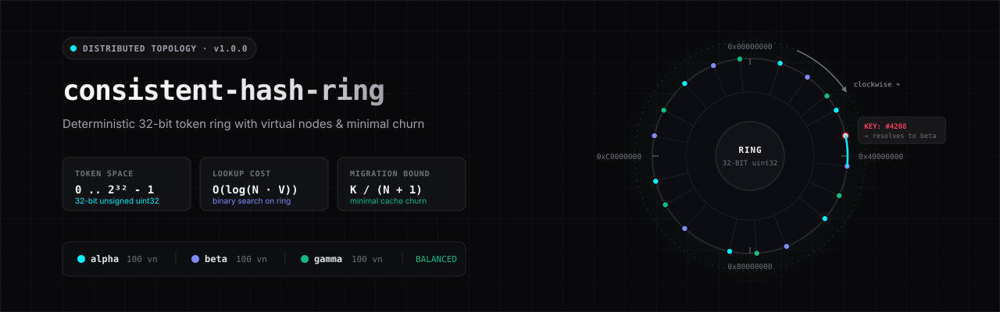

<p align="center">
  
</p>

<p align="center">
  <a href="package.json"></a>
  <a href="tsconfig.json"></a>
  <a href="src/test/run-tests.ts"></a>
  <a href="LICENSE"></a>
  <a href="package.json"></a>
</p>

`consistent-hash-ring` is a deterministic consistent hashing ring with virtual nodes, clockwise binary search, and an interactive terminal CLI in TypeScript.

---

## Quickstart

### Installation

Clone the repository and install dev dependencies:

```bash
git clone https://github.com/YuvvrajSingh/consistent-hash-ring.git
cd consistent-hash-ring
npm install
npm run build
```

### TypeScript Usage

```typescript
import { ConsistentHashRing } from './dist/index.js';

// 1. Initialize the ring (defaults to 100 vnodes per server, MD5 hash)
const ring = new ConsistentHashRing({ defaultVnodes: 100, hashAlgorithm: 'md5' });

// 2. Register physical servers
ring.addServer('cache-01');
ring.addServer('cache-02');
ring.addServer('cache-03');

// 3. Store keys
ring.addData(1042, { session: 'user_abc123' });
ring.addData(8901, { session: 'user_xyz789' });

// 4. Resolve the target server for a key (O(log(N · V)))
const match = ring.getNode(1042);
console.log(match);
// {
//   server: { id: 'cache-02' },
//   vnode: { vnodeId: 'cache-02#47', serverId: 'cache-02', replicaIndex: 47, token: 2341908211 },
//   keyToken: 2195048210
// }

// 5. Inspect cluster load metrics
const stats = ring.getDistributionStats();
console.log(`Cluster keys: ${stats.totalKeys}, StdDev: ${stats.stdDev.toFixed(2)}, Load Ratio: ${stats.loadRatio.toFixed(2)}x`);
```

---

## Mechanics

Traditional modulo hashing assigns keys to servers using:

$$\text{serverIndex} = \text{hash}(\text{key}) \pmod N$$

When the server count $N$ changes (e.g., adding or removing a node), almost every key hashes to a different index. Specifically, $\frac{N}{N + 1}$ of all keys (80% when moving from 4 to 5 nodes) churn across the cluster, wiping out cache hit rates and causing cache stampedes.

Consistent hashing solves this by arranging hash tokens in a circular 32-bit ring.

```
                         0x00000000 [ 0° ]
                           ┌───────────┐
                     ┌─────┘           └─────┐
        0xC0000000  │        TOKEN RING       │  0x40000000
          [ 270° ]   │       2³² - 1 space     │   [ 90° ]
                     └─────┐           ┌─────┘
                           └───────────┘
                         0x80000000 [ 180° ]
```

### 1. 32-Bit Integer Token Space

The ring represents the unsigned 32-bit integer range $[0, 2^{32} - 1]$ ($0$ to $4{,}294{,}967{,}295$). Both physical server virtual nodes and user data keys hash to points on this perimeter using 32-bit unsigned hashes (truncated MD5, SHA-256, or MurmurHash3).

### 2. Clockwise Binary Search: $O(\log(N \cdot V))$

To resolve which server owns a key:
1. Compute the key's token: $T_k = \text{hash}(\text{key})$.
2. Binary search the sorted array of $N \cdot V$ tokens for the first token $T_v \ge T_k$.
3. If $T_k$ exceeds the maximum token in the ring, wrap around clockwise to index `0` (the lowest token).
4. Return the physical server owning virtual node $T_v$.

Lookup cost is $O(\log(N \cdot V))$, requiring at most 9 comparisons for a cluster of 5 servers with 100 virtual nodes each (500 tokens).

### 3. Virtual Nodes for Variance Reduction

Mapping each physical server to only 1 token produces non-uniform segment lengths along the circle, creating severe load imbalance where one server receives 3x or 4x the traffic of another.

By assigning $V$ virtual nodes (default: 100) per physical server:
* Each physical server owns $V$ randomly distributed positions across the circle.
* Server segments interleave throughout the ring.
* The standard deviation across server key counts drops by a factor of $\approx \sqrt{V}$.

### 4. Minimal Churn: $K / (N + 1)$

When adding the $(N+1)$-th server to an $N$-server cluster:
* The new server's virtual nodes claim small slices from existing tokens around the ring.
* Only keys falling inside those new slices migrate to the new server.
* The theoretical fraction of keys that move is:

$$\text{Migration Fraction} = \frac{1}{N + 1}$$

* The remaining $\frac{N}{N + 1}$ of keys remain on their current nodes.
* **Invariant:** Exactly 0 keys move between the existing $N$ servers.

---

## Interactive CLI & REPL

The package ships with an interactive command-line interface and step-by-step migration demo.

```bash
# Run the interactive terminal REPL
npm start

# Run the automated step-by-step visual migration demo
npm run demo

# Print CLI help
npm run cli -- --help
```

### REPL Commands

| Command | Arguments | Description |
| :--- | :--- | :--- |
| `add-server` | `<id> [vnodes]` | Register a physical server with virtual node replicas |
| `remove-server` | `<id>` | Evict a physical server and reallocate its keys clockwise |
| `servers` | — | List all physical servers, vnode counts, and metadata |
| `add-data` | `<number> [payload]` | Insert a key and optional payload onto the ring |
| `add-range` | `<start> <end>` | Batch-insert sequential numeric keys `[start..end]` |
| `lookup` / `get` | `<number>` | Find target server, vnode ID, and token via binary search |
| `list-data` | `[serverId]` | List stored keys, optionally filtered by server |
| `stats` / `distribution` | — | Print distribution stats and load bar charts |
| `ring` | — | Display ASCII 32-bit ring topology and arc density |
| `simulate-add` | `<id> [vnodes]` | Compute migration plan without mutating ring state |
| `demo` | — | Run the automated 5-step visual demonstration |
| `clear` | — | Clear the terminal window |
| `help` | — | Display command reference |
| `exit` / `quit` | — | Exit the REPL |

---

## Empirical Benchmarks & Distribution Data

The following metrics were measured with 5 physical servers, 5,000 keys, and uniform key distributions across varying virtual node counts:

### Variance Reduction vs Virtual Node Count

| Vnodes / Server ($V$) | Total Tokens ($N \cdot V$) | Mean Keys / Node | Std Deviation ($\sigma$) | Coeff. of Variation ($\text{CV}$) | Peak / Mean Load Ratio |
| :---: | :---: | :---: | :---: | :---: | :---: |
| **5** | 25 | 1,000 | 339.37 | 33.9% | 1.50x |
| **10** | 50 | 1,000 | 246.40 | 24.6% | 1.43x |
| **20** | 100 | 1,000 | 94.60 | 9.5% | 1.08x |
| **50** | 250 | 1,000 | 91.47 | 9.1% | 1.12x |
| **100** | 500 | 1,000 | 73.54 | 7.4% | 1.08x |
| **200** | 1,000 | 1,000 | 75.59 | 7.6% | 1.11x |
| **500** | 2,500 | 1,000 | 49.93 | 5.0% | 1.05x |

### Minimal Churn Verification

Adding a 5th server (`srv-4`) to a 4-node cluster ($N=4 \to 5$) holding 4,000 keys with 100 vnodes per server:

```
Theoretical migration: 1 / (N + 1) = 20.00% (800 keys)
Observed migration   : 23.00% (920 keys transferred to srv-4)
Churn between srv-0, srv-1, srv-2, srv-3: 0 keys (100% stable)
```

With traditional modulo hashing, 3,200 of 4,000 keys (80.0%) would be evicted. Consistent hashing preserved 77.0% of the cache entries.

---

## Trade-Offs & Operational Limits

Consistent hashing is not a silver bullet. Review these constraints before deploying in a storage tier:

### 1. Memory Footprint of Token Arrays

Every virtual node adds an entry to the sorted `tokens` array:

$$\text{Tokens} = N \cdot V$$

* 100 servers with 100 vnodes = 10,000 elements.
* In-memory memory overhead in V8 is small (< 1 MB for 10,000 objects), but keeping replica rings synchronized across client libraries requires transmitting the token list on membership changes.
* For clusters with thousands of servers, keep $V \in [50, 150]$ to balance distribution uniformity against ring state size.

### 2. Lookup vs Mutation Latency

* **Read lookup:** $O(\log(N \cdot V))$ via binary search. Finding the owner of a key among 1,000 tokens takes under 2 microseconds.
* **Server addition / removal:** $O(V \log(N \cdot V))$ because inserting $V$ new tokens requires sorting the ring array. Adding a server is an administrative operation rather than a per-request operation.

### 3. Distributed Coordination Requirements

`ConsistentHashRing` is an in-memory routing engine. It does not handle network partitions or transport consensus. In a distributed deployment:
* Nodes must agree on ring membership through an external consensus mechanism (e.g., Raft, etcd, Consul) or a gossip protocol (e.g., SWIM).
* Clients must either query a gateway proxy or maintain a local replica of the ring updated via membership events.

### 4. Skew with Small Virtual Node Counts

Configuring fewer than 30 vnodes per server produces high load variance ($\text{CV} > 20\%$). If a cluster contains only 3 servers with 10 vnodes each, one server may receive 45% of traffic while another receives 15%. Keep default vnodes at $\ge 100$ unless memory or network constraints dictate otherwise.

---

## API Reference

### `ConsistentHashRing`

```typescript
class ConsistentHashRing {
  constructor(options?: ConsistentHashRingOptions);

  // Cluster topology
  addServer(serverId: string, vnodeCount?: number, metadata?: Record<string, unknown>): void;
  removeServer(serverId: string): { reallocatedKeys: { key: number; newServerId: string | null }[] };
  hasServer(serverId: string): boolean;
  getServers(): PhysicalServer[];
  getVnodes(): VirtualNode[];

  // Routing
  getNode(key: string | number): NodeLookupResult | null;

  // Key storage & metrics
  addData(key: number, data?: any): AddDataResult;
  getData(key: number): DataRecord | null;
  removeData(key: number): boolean;
  getAllData(): DataRecord[];
  getServerData(serverId: string): number[];
  getDistributionStats(): DistributionStats;

  // Dry-run planning
  simulateAddition(newServerId: string, vnodes?: number): MigrationPlan;
}
```

### Hasher Helpers

```typescript
// Deterministic 32-bit unsigned integer hash [0, 2^32 - 1]
function hashKey(val: string | number, algorithm?: 'md5' | 'sha256' | 'murmur3'): number;

// 32-bit MurmurHash3 implementation
function murmurHash3(key: string, seed?: number): number;

// Pre-bound hasher factory
function createHasher(algorithm?: 'md5' | 'sha256' | 'murmur3'): (val: string | number) => number;
```

---

## Testing & Quality Verification

Run the verification test suite:

```bash
npm test
```

The test runner has zero external dependencies and runs 32 assertion checks across 8 suites:
1. `Ring Initialization & Option Defaults`
2. `Deterministic Hashing`
3. `Clockwise Binary Search`
4. `Server Add & Remove`
5. `Numerical Data Keys`
6. `Vnode Distribution Uniformity`
7. `Minimal Churn Property Verification`
8. `Edge Cases & Error Handling`

Run typechecking and production build:

```bash
npm run lint   # tsc --noEmit
npm run build  # tsc
```

---

## License

MIT © [Yuvraj Singh](https://github.com/YuvvrajSingh)
